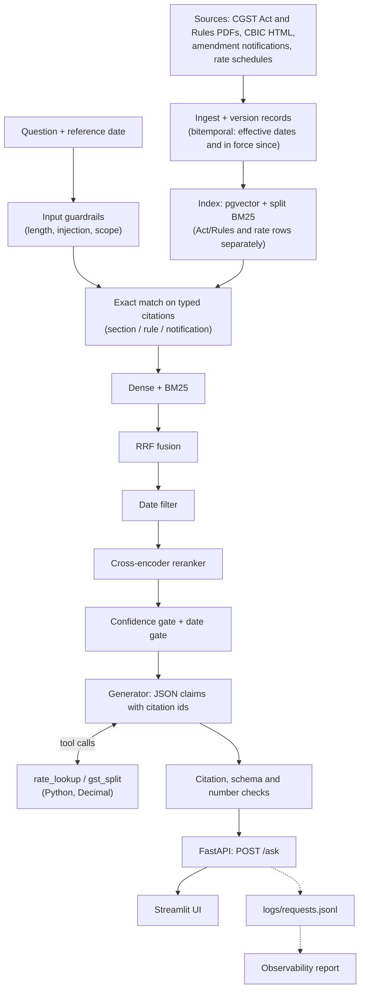
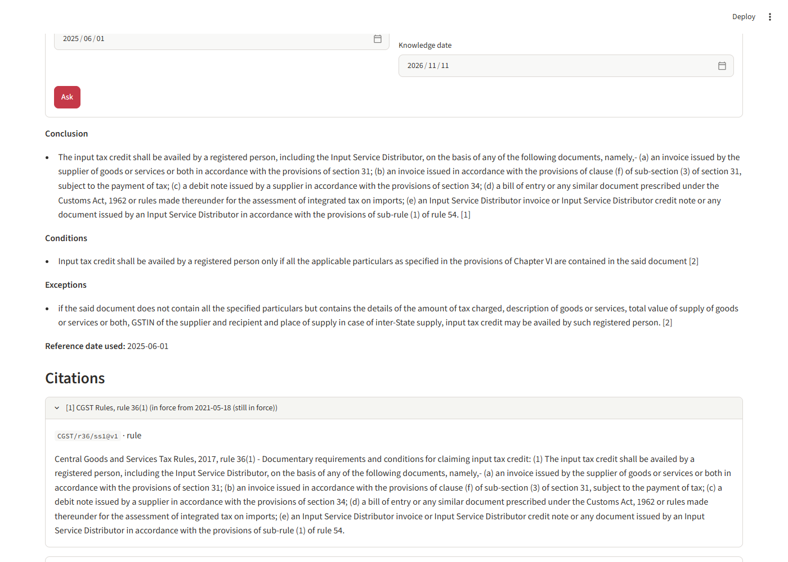
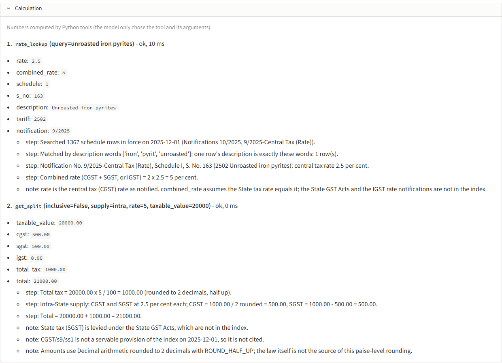
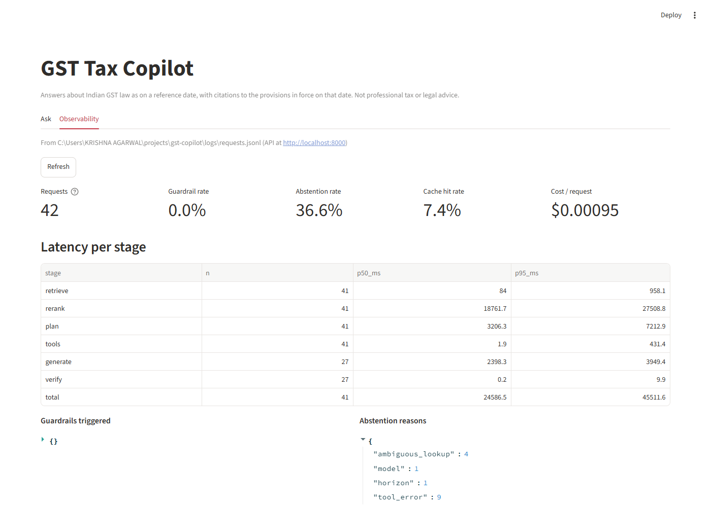

# GST Tax Copilot

A citation-grounded assistant for Indian GST law that answers **as of a date**. It keeps
every provision as dated versions, finds the version in force on the question's reference
date with hybrid retrieval, and cites it. It abstains when the evidence is thin, refuses
off-topic or injected prompts, and leaves arithmetic to deterministic calculator tools.
Every request is logged for observability. Its evaluation uses an LLM judge that was checked
against human labels. The domain is Indian GST, but the design applies to any regulated,
versioned document corpus.

## Key results (test split, frozen)

| Metric | Result |
|---|---|
| Answer correct rate | 53/64 = 0.828 (95% CI 0.734–0.922) |
| Citation precision / recall | 61/62 / 61/64 = 0.953 |
| Retrieval MRR@10, naive → with date filter | 0.193 → 0.976 (0.984 with the reranker) |
| Judge agreement with human labels | 32/34, Cohen's κ 0.89 (previous judge: 29/34, κ 0.72) |
| Guardrail refusal precision / recall | 0.909 / 1.000 (30-question guardrail set) |
| Generator cost per request (estimate) | about $0.0018 at list price; $0 on the Gemini free tier |

Main test run with calculator tools off; calculator results reported separately. On a
hand-written calculation set (n=15): tool selection 14/15, arguments 13/14, final-number exact
match 5/12 (see [docs/RESULTS.md](docs/RESULTS.md), section 8).

<sub>Shipped API config replayed on the frozen test answers: 0/64 outcomes changed
(guardrails, strict_claims, number check). Tool selection on test was not replayed; see
[docs/RESULTS.md](docs/RESULTS.md).</sub>

## How it works



## What makes it different

- **Bitemporal versioning.** Each provision version carries `effective_from`, `effective_to`
  and `in_force_since`, so it can answer as the law stood on a date and as it was known on a
  date.
- **Date-filtered retrieval.** Only the version valid on the reference date competes. On
  test this lifts MRR@10 from 0.642 to 0.976.
- **Citations are a data check.** The LLM returns claims with citation ids. Ids outside the
  retrieved context are dropped, and the prose is rendered from a fixed template.
- **The LLM never does arithmetic.** Rates and tax amounts come from pure, unit- and
  property-tested Python tools. An answer that used a tool abstains if it contains a number
  that is not in a tool output or cited text.
- **A measured judge and root-cause fixes.** The LLM judge was checked against 34
  human-labelled rows. Errors were traced to their causes: for example, a false abstention
  led to a rate-schedule extraction defect, and fixing it took test rate questions from 13/16
  to 16/16.

## Screenshots

| Ask | Calculation | Observability |
|---|---|---|
|  |  |  |

<sub>Screenshots to be added.</sub>

## How to run

You need Python 3.11+ and Docker.

```bash
uv sync --all-extras          # or pip-install the dependencies and extras in pyproject.toml
cp .env.example .env          # then fill in the keys below
docker compose up -d          # Postgres 16 + pgvector on localhost:5432
python -c "from retrieval.pipeline import build_indexes; from retrieval.store import open_store; from retrieval.embed import Embedder; print(build_indexes(open_store(), Embedder()))"
uvicorn api.app:app --port 8000
streamlit run ui/app.py       # second terminal; GST_API_URL overrides http://localhost:8000
```

`.env` keys (names only):

| Key | Needed for |
|---|---|
| `GEMINI_API_KEY` | the generator (API and generation evals) |
| `GROQ_API_KEY` | the judge (generation evals only) |
| `GEMINI_MODEL`, `GEMINI_FALLBACK_MODEL`, `GROQ_MODEL`, `GROQ_FALLBACK_MODEL` | optional model overrides |

Usage notes:
- **Building the index** (first run only) needs `data/processed/` and the source files listed
  in `data/raw/manifest.json`.
- **Check the store:** if Postgres is not reachable, the retriever falls back to an empty
  LanceDB store, so confirm that `GET /health` reports `"store": "pgvector"`.
- **First request:** it loads the embedding and cross-encoder models and takes 30 seconds or
  more.
- **Request format:** `POST /ask` takes `{"question", "reference_date", "knowledge_date"?}`.
  Interactive docs are at http://localhost:8000/docs.
- **Request log:** every request appends one JSON line to `logs/requests.jsonl` (override the
  path with `GST_REQUEST_LOG`). It records a hash of the question, never the text, and no
  prompts or keys.

## Reproduce the evaluation

```bash
pytest                                              # unit tests; stub generator, no LLM calls
python -m eval.retrieval --split dev --no-rebuild   # retrieval ablation ladder
python -m eval.generation --split dev --tag <name>  # generation eval on dev (judge v2)
python -m eval.calc                                 # calculation eval through the API path
python -m eval.guardrails                           # guardrail refusal precision/recall
python -m observability.report                      # latency, abstention, tokens, cost
```

The test split is frozen. Its final run is committed, and `eval.generation` refuses to
overwrite an existing test run. Results are appended to `eval/results/` and written up in
[docs/RESULTS.md](docs/RESULTS.md).

## Repo map

| Folder | Contents |
|---|---|
| `api/` | FastAPI app: `POST /ask`, `GET /health`, request and response models |
| `assets/` | images for this README (`assets/img/`) |
| `data/` | raw sources with a manifest (`raw/`), versioned records (`processed/`), LLM cache |
| `docker/` | Postgres + pgvector init script |
| `docs/` | the results write-up, [docs/RESULTS.md](docs/RESULTS.md) |
| `eval/` | eval sets, the dev/test split, eval scripts, and `results/` |
| `generation/` | context, prompts, gates, guardrails, tool routing, verification, rendering |
| `gst_copilot/` | shared record models |
| `ingest/` | acquire, parse, segment and version the Act, Rules and notifications |
| `observability/` | request log, price table and report |
| `retrieval/` | corpus rows, exact match, BM25, dense, fusion, reranker, stores |
| `tests/` | unit and property tests |
| `tools/` | deterministic calculators: `rate_lookup`, `gst_split` |
| `ui/` | Streamlit UI (Ask, Calculation panel, Observability) |

## Limitations

- **GST only:** the CGST Act, CGST Rules and central tax rate notifications.
- **Interpretive questions are the weakest:** 1/4 correct on test, retrieval Recall@10 0.625;
  with n=4 this is very uncertain.
- **Undated Rules amendments are not applied:** 6 instructions take effect "from a date to be
  notified".
- **Rate amendments 19/2025 and 01/2026 are not applied** to the index rows, so the rates
  horizon is 2026-01-31.
- **Small hand-written test set:** 20 items, beside 44 templated ones. The test split has
  been run three times, with no tuning on test.

Details and sources for every number: [docs/RESULTS.md](docs/RESULTS.md).
